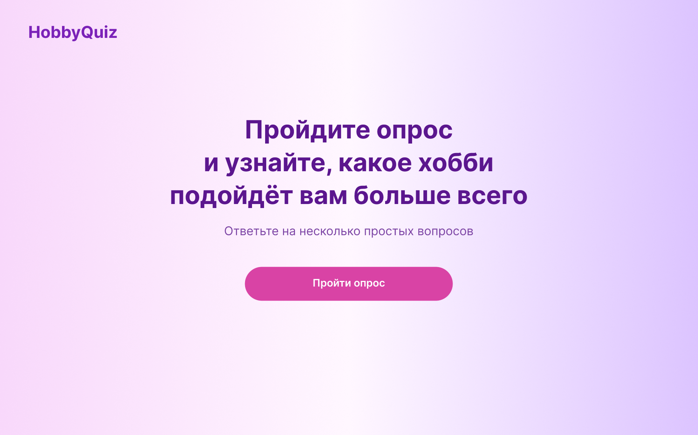
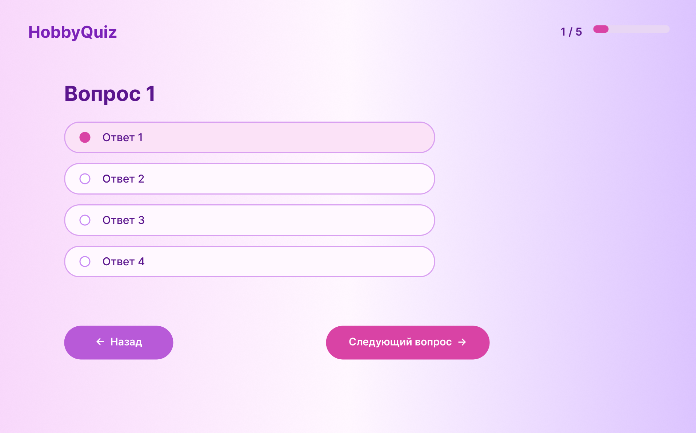
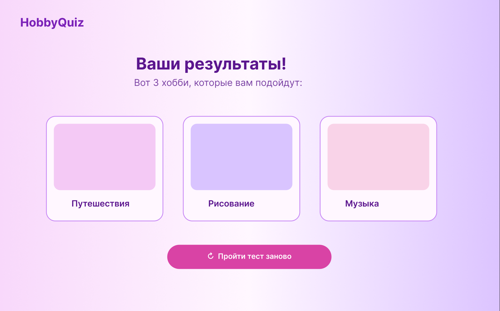
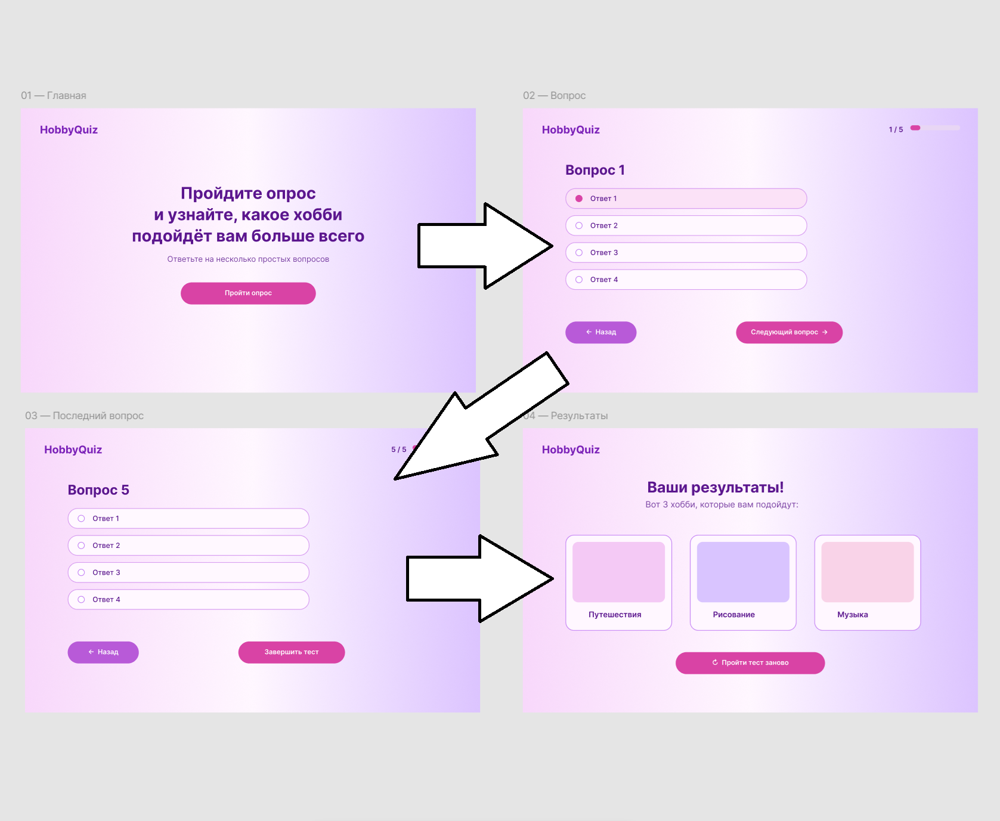

# Отчёт о выполнении самостоятельной работы №5: Разработка интерфейса

* **Дисциплина:** Введение в профессиональную деятельность
* **Команда:** «Винкс» (Группа 644, бригада №4)
* **Тема проекта:** «Создание сервиса подбора хобби»
* **Руководитель проекта:** Капитанский Андрей

---

## 1. Перечень экранов

* **Главный экран (Стартовая страница)** — точка входа на сайт; знакомит пользователя с концепцией сервиса-опросника, объясняет его суть и позволяет запустить прохождение теста нажатием одной кнопки.
* **Экран прохождения опроса (Вопросы)** — основной рабочий экран для сбора предпочтений и ограничений пользователя (бюджет, свободное время, формат занятий и др.); включает прогресс-бар, формулировку вопроса, варианты ответов и кнопки навигации между шагами теста (включая финальный шаг с завершением опроса).
* **Экран результатов** — итоговая страница, отображающая персональную подборку из 3 наиболее подходящих хобби на основе ответов пользователя, а также позволяющая перезапустить тест при желании получить новые рекомендации.

## 2. Эскизы (макеты) основных экранов

### Главный экран

### Экран прохождения опроса (Вопросы)

### Экран результатов

## 3. Карта навигации

## 4. Обоснование решений интерфейса

При проектировании интерфейса мы опиралась на потребности целевой аудитории («Студенты и молодёжь» и «Работающие люди»):

* **Отсутствие регистрации и лишних разделов:** оба сегмента аудитории хотят получить быстрый результат без заполнения длинных форм и сложных настроек. Поэтому пользователь сразу попадает на целевое действие — кнопку «Пройти опрос».
* **Пошаговый формат с прогресс-баром:** молодые и занятые пользователи ценят своё время. Счётчик шагов (`1/5`) и шкала прогресса снижают когнитивную нагрузку и показывают, что прохождение теста займёт пару минут.
* **Минимализм и крупные элементы управления:** светлая пастельная палитра не утомляет глаза, а контрастные кнопки и крупные карточки ответов одинаково удобны как на ПК, так и на экранах смартфонов.
* **Ограничение выдачи до 3 вариантов:** вместо длинного каталога пользователь получает ровно 3 наиболее релевантных хобби, что избавляет его от «паралича выбора» и помогает быстрее определиться с занятием.

## 5. Вывод

В ходе выполнения самостоятельной работы №5 команда спроектировала структуру пользовательского интерфейса сервиса `HobbyQuiz` на основе функциональных требований из СР №4 и потребностей целевой аудитории из СР №3. Были определены ключевые экраны, подготовлены их макеты и выстроена логичная карта навигации.

## 6. Отчёты участников о проделанной работе

* **Капитанский Андрей (Руководитель проекта):** координировал работу команды над пятой самостоятельной работой, определил финальный перечень экранов на основе требований из СР №4, сформулировал обоснование интерфейсных решений с опорой на целевую аудиторию и оформил итоговый отчёт.
* **Пустовой Борис (Программист):** создал визуальные макеты основных экранов в Figma, настроил сетку элементов и подготовил графические материалы для последующей реализации прототипа.
* **Зокиров Тимур (Архитектор ПО):** совместно с программистом разработал дизайн-концепцию сайта, цветовую палитру, стили кнопок и карточек, а также продумал логику переходов между экранами.

*Примечание:* В этой работе задачи специалиста по данным (Маскаев Владислав) и тестировщика (Загрудный Данила) не требовались, так как мы делали только визуальные макеты. Они подключатся на следующем этапе — при сборке и проверке полноценного прототипа сайта.
